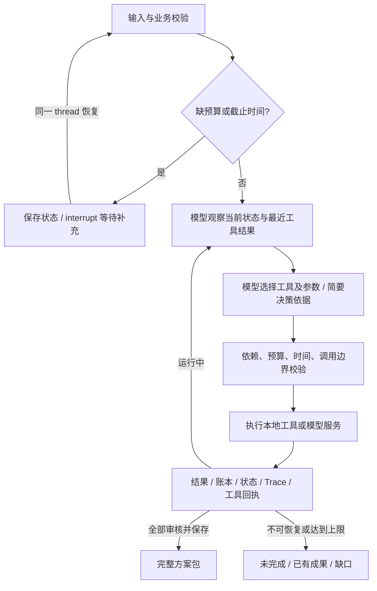

# 方案与工程取舍

## 决策循环

LangGraph 只有 `prepare → decide → execute → decide` 的执行骨架。`decide` 使用 LangChain 的模型工具调用接口选择八个工具之一；并非 Python 分支替模型选择业务动作。程序只决定合法性、记账、终止边界与结果保存。

八个工具：`load_context`、`search_assets`、`revise_plan`、`estimate_cost`、`generate_script`、`review_content`、`save_campaign`、`stop`。每次只执行一个工具，后续选择必须基于已经返回的结果。Trace 不保存模型内部思维，只保存显式工具调用、参数、简要理由和观察。

市场策略以输入 brief 为依据。模型先读取合成事实与规则，再分别检索两个市场素材，创建完整任务计划。初次报价可能超限；模型可选择不同档位，或仅调整未完成任务。档位是模拟服务费用/耗时的差异，共用同一个最低质量标准，不能通过删字段“降价”。

## 状态与数据

`domain.py`：输入/计划/脚本/审核契约与确定性验证。`tools.py`：业务工具、估算和费用边界。`providers.py`：真实模型与独立标识的离线策略。`agent.py`：状态图与中断。`storage.py`：业务状态及操作回执。`service.py`：CLI 和 Streamlit 共用的创建/恢复/导出接口。

状态包含 brief、市场资料、已检索素材、计划版本、产物及其任务哈希、当前报价、累计支出/分钟、调用次数、尝试次数、Trace 和保存路径。历史计划/被拒绝产物保存在 Trace 的实际参数和结果中。失败审核意见与被拒绝文本另存 feedback，重规划失效产物时不删除这些修复依据，审核通过后才清除。模型只看到业务状态和反馈，不看到故障注入场景名。

## 预算与依赖

`estimate_cost` 分别返回已花费用、剩余费用、预计总额、剩余时间、预算/时间缺口及可选档位。已生成的内容不重复计生成费用，已审核内容不重复计审核费用。每次执行仍检查实际累计值，防止报价后失败消耗让原方案失效。

模型决定是否停止；程序依据账本生成最终已花费用、最低完成总额及缺口。模型原始理由仍在 Trace 中，可供核查，但其中的口算与替代报价不能当成已验证报价。预算不够时保留成果并请求明确调整；不会自行减少市场或方案数量。

生成依赖已检索资料、完整有效计划和当前版本报价；审核依赖真实脚本；保存依赖全部审核通过和素材仍可读取。每个任务的哈希控制缓存有效性。改变一个任务不使无关任务失效。

## 故障与恢复

| 失败 | 反馈及恢复 |
| --- | --- |
| 缺关键约束 | LangGraph interrupt，补齐同一任务继续 |
| 参数或素材市场不匹配 | 结构化错误交回模型；未发生业务执行不扣费 |
| 素材丢失/内容变化 | 文件存在性与 SHA-256 检查；模型改选素材 |
| 服务临时失败 | 记录实际模拟消耗；模型决定是否重试/调整 |
| 服务持续失败 | 每任务生成尝试上限 + 全局调用上限；显式未完成 |
| 质量不合格 | 保留拒绝内容和问题；模型修复该条并重新审核 |
| 保存失败 | 已审核产物保留；单独重试保存 |
| 模型不可用/结构输出错误 | 结构化错误或未完成；不使用 Mock 冒充真实恢复 |
| 进程中断 | 本地 SQLite 保留结果；显式恢复继续未完成部分 |

LangGraph SQLite 检查点负责图状态和等待恢复，独立业务 SQLite 事务负责账本与工具回执。图重放同一 operation ID 时返回原回执，不重复扣模拟费用。同一任务使用文件锁避免 CLI/UI 并发修改。保存采用确定路径与原子文件替换。

方案先写 Markdown，再写作为完成凭证的 JSON。任一写入失败不能宣告完整保存成功。复用导出目录时移除不属于当前任务的旧方案文件，界面也只为已保存任务提供方案下载，避免把历史成功文件挂到当前未完成任务下。

边界：这不承诺外部模型请求的 exactly-once 计费。网络超时可能已经消耗供应商资源，当前供应商没有业务回执查询接入。实际部署外部付费/渲染工具前，需要适配供应商幂等键和作业状态查询。本项目可控本地工具的重复执行和模拟账本已单独测试。

## 质量检查

程序检查语言标识、任务对应关系、分镜连续覆盖 20 秒、素材引用和允许的事实 ID，另有有限的未证实卖点词表，扫描面向用户的文案而不是可能引用禁用词进行否定的说明。已知未证实的轻量、耐用、环保和安全承诺同样拦截。随后模型按语言自然度、市场适配、事实证据各 1–5 分审核，要求全部至少 4 分、无问题且同意通过。模型审核仍存在同源偏差；不能替代母语运营人员审稿，也不构成实际营销效果证明。

## 技术选择与来源

沿用用户熟悉的 LangGraph + LangChain，版本记录在 `requirements.lock`。LangGraph 负责图、SQLite checkpoint 和 interrupt；LangChain 组件负责标准模型调用、工具 schema 和结构化输出。无需重新实现框架。

已验证版本：Python 3.12.9、LangGraph 1.2.20、langgraph-checkpoint-sqlite 3.1.3、LangChain 1.4.9、langchain-openai 1.7.4、Streamlit 1.67.0；完整依赖使用锁文件安装。

- [LangGraph persistence](https://docs.langchain.com/oss/python/langgraph/persistence)：采用持久化检查点。
- [LangGraph interrupts](https://docs.langchain.com/oss/python/langgraph/interrupts)：暂停/恢复及节点重执行的幂等要求。
- [LangGraph error handling](https://docs.langchain.com/oss/python/langgraph/thinking-in-graph-api)：区分临时错误、模型可修复错误、用户补充与程序错误。
- [LangChain models](https://docs.langchain.com/oss/python/langchain/models)：模型工具调用与结构化输出接口。
- [Anthropic agent patterns](https://www.anthropic.com/research/building-effective-agents)：依据环境反馈调整与设置停止边界。

CLI 是正式可复现入口。Streamlit 只展示和调用同一个 Service，不实现另一套 Agent 逻辑。所有报告在本地，未开启第三方 Trace 上传。
